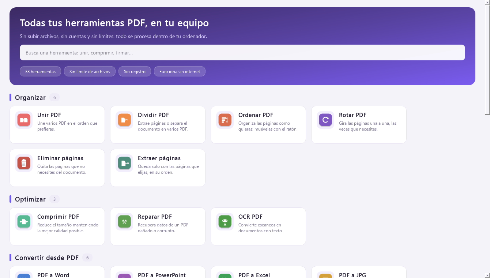
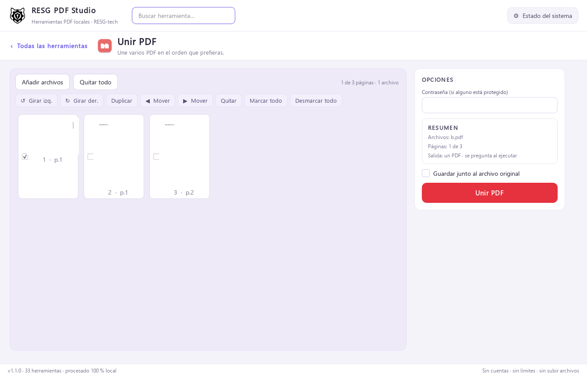
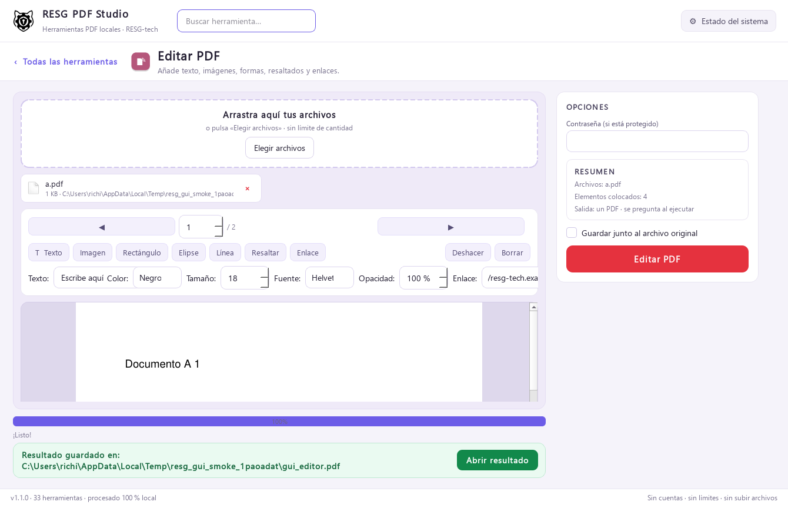
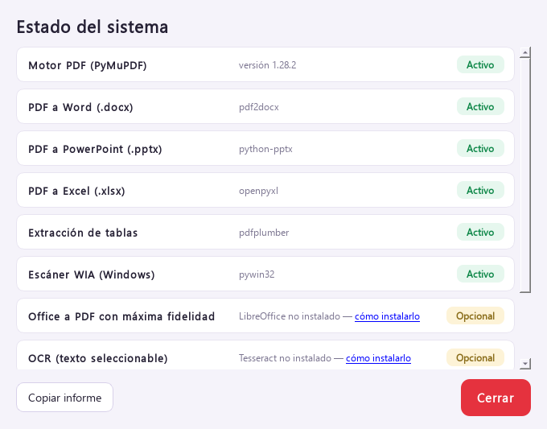

# RESG PDF Studio

Suite de herramientas PDF **100 % local** para Windows, Linux y macOS, con
interfaz de escritorio (PyQt6) y toda la lógica en Python.

Tus archivos **nunca salen de tu equipo**: no hay servidores, ni cuentas, ni
base de datos, ni límite de archivos o páginas.


## Qué la hace especial

| | |
|---|---|
| 🔒 **Privada por diseño** | Todo se procesa en tu ordenador. La única función que usa la red es «HTML a PDF» cuando le pasas una URL. |
| ♾️ **Sin límites ni cuentas** | Añade 1 o 400 archivos: no hay bloqueos, ni registro, ni sesiones, ni marcas de agua comerciales. |
| 🖼️ **Vista de miniaturas** | Al cargar los archivos ves cada página y **la arrastras para decidir su orden**, la giras, la duplicas, la marcas o la quitas. |
| ✍️ **Firma a mano** | Dibuja tu firma con el ratón (o el lápiz) y se estampa en el PDF como PNG transparente. |
| 🧩 **Editor visual** | Texto, imágenes, formas, resaltados, líneas y enlaces colocados con el ratón sobre la página. |
| 🧠 **Resumen local** | Ideas clave y palabras relevantes del documento, calculadas en tu equipo. |
| ⚙️ **Motores opcionales detectados** | LibreOffice, Tesseract (OCR), Ghostscript (PDF/A) y argostranslate (traducción) se detectan solos. |

## Herramientas incluidas (33)

| Categoría | Herramientas |
|---|---|
| **Organizar** | Unir PDF · Dividir PDF · Ordenar PDF · Rotar PDF · Eliminar páginas · Extraer páginas |
| **Optimizar** | Comprimir PDF · Reparar PDF · OCR PDF |
| **Convertir desde PDF** | PDF a Word · PDF a PowerPoint · PDF a Excel · PDF a JPG · PDF a Markdown · PDF a PDF/A |
| **Convertir a PDF** | JPG a PDF · Word a PDF · PowerPoint a PDF · Excel a PDF · HTML a PDF · Escanear a PDF |
| **Editar** | Editar PDF (editor visual) · Marca de agua · Firmar PDF · Números de página · Recortar PDF · Censurar PDF · Formularios PDF |
| **Seguridad** | Proteger PDF (AES-256) · Desbloquear PDF · Comparar PDF |
| **Inteligencia** | Resumir PDF (local) · Traducir PDF (motor local opcional) |

## Capturas

| Inicio | Miniaturas y orden de páginas |
|---|---|
|  |  |

| Editor visual | Estado del sistema |
|---|---|
|  |  |

## Requisitos

- **Windows 10/11**, Linux o macOS.
- **Python 3.10+** solo si lo ejecutas desde el código fuente; el `.exe` no
  necesita Python.
- Herramientas externas **opcionales** (todas gratuitas) que amplían funciones:
  - [LibreOffice](https://www.libreoffice.org) → Word/Excel/PowerPoint a PDF con
    máxima fidelidad (sin él se usa el motor interno, que ya funciona).
  - [Tesseract OCR](https://github.com/UB-Mannheim/tesseract/wiki) → OCR (instala
    el idioma **Spanish** durante el setup).
  - [Ghostscript](https://ghostscript.com) → PDF/A.
  - `pip install argostranslate` → «Traducir PDF» (motor local; los modelos se
    descargan con `argospm`).

## Ejecutar desde el código fuente

```bash
git clone https://github.com/USUARIO/RESG-PDF-Studio.git
cd RESG-PDF-Studio
pip install -r requirements.txt
python main.py
```

En Windows también puedes hacer doble clic en `run.bat`.

## Generar el .exe (un solo archivo)

```bash
python build_exe.py
```

El resultado queda en `dist/RESG-PDF-Studio.exe`, un único archivo portable.
En Windows existe además `build_exe.bat`, que ejecuta las pruebas antes de
empaquetar. Más detalles en [docs/COMPILAR.md](docs/COMPILAR.md).

## Pruebas

```bash
python tools/selftest.py               # 50 comprobaciones del backend
python tools/gui_smoke.py              # 26 comprobaciones de interfaz
python tools/gui_smoke.py --capturas   # además guarda capturas/ *.png
```

Ambos scripts funcionan sin pantalla (la prueba de interfaz usa la plataforma
«offscreen» de Qt), así que se pueden lanzar en un servidor o en CI.

## Documentación

- [Guía de uso](docs/USO.md) — miniaturas, editor, firma y opciones.
- [Arquitectura](docs/ARQUITECTURA.md) — cómo está organizado el código.
- [Compilar y publicar](docs/COMPILAR.md) — `.exe`, CI y releases.
- [Historial de cambios](CHANGELOG.md) — qué hay en cada versión.
- [Cómo contribuir](CONTRIBUTING.md) · [Seguridad](SECURITY.md) ·
  [Código de conducta](CODE_OF_CONDUCT.md).

## Estructura del proyecto

```
RESG-PDF-Studio/
├── main.py                  # punto de entrada
├── build_exe.py             # build del .exe en un comando
├── resg_pdf_studio.spec     # configuración de PyInstaller
├── assets/                  # logos + 33 iconos de herramientas
├── docs/                    # guía de uso, arquitectura y compilación
├── tools/
│   ├── selftest.py          # pruebas del backend
│   ├── gui_smoke.py         # pruebas de interfaz + capturas
│   ├── generate_icons.py    # genera los iconos PNG
│   └── preparar_github.py   # carpeta limpia lista para publicar
└── resg_pdf/
    ├── backend/tools.py     # TODA la lógica PDF (una función por herramienta)
    └── ui/                  # registro, páginas, miniaturas, editor y estilo
```

## Privacidad

Todo el procesamiento ocurre en local. Las únicas funciones que pueden tocar la
red son opcionales y siempre a petición tuya:

- «HTML a PDF» cuando le pasas una dirección web (para descargar esa página).
- «Traducir PDF» solo si instalas el motor local `argostranslate`; el texto se
  traduce en tu equipo, sin servicios externos.

## Licencia

Publicado bajo licencia **AGPL-3.0** — ver [LICENSE](LICENSE).

PyMuPDF (el motor PDF) también se distribuye bajo AGPL: si publicas o vendes un
derivado, revisa sus términos o adquiere una licencia comercial.
